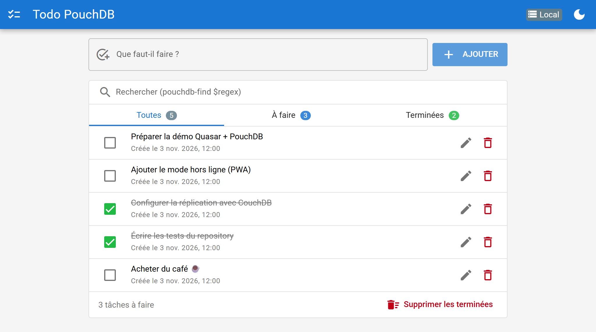
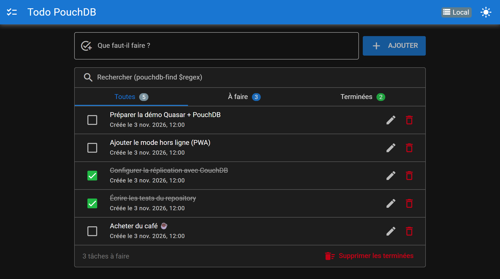
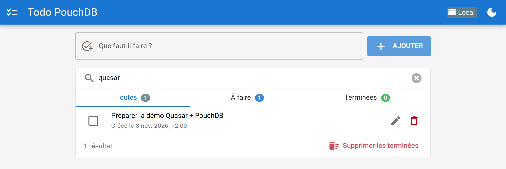
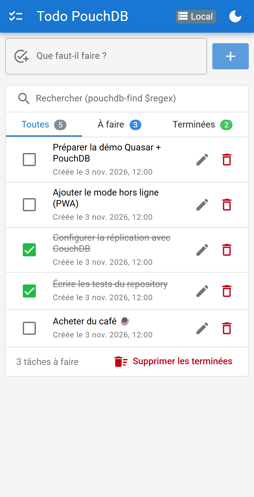
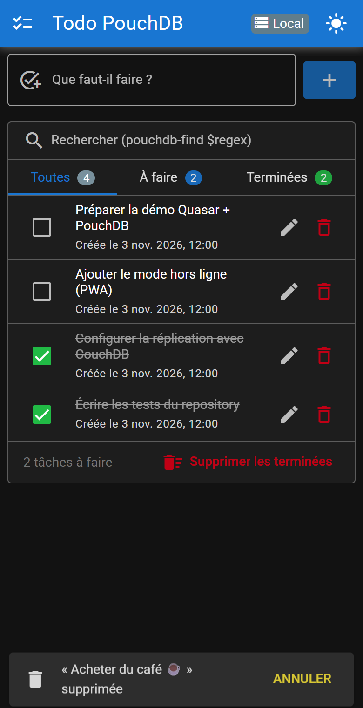

# Quasar Todo List · PouchDB

POC d'une todo list **offline-first** : les données vivent dans le navigateur (IndexedDB via
[PouchDB](https://pouchdb.com)) et peuvent être synchronisées en temps réel avec un serveur
[CouchDB](https://couchdb.apache.org).

| Clair                                                   | Sombre                                             |
| ------------------------------------------------------- | -------------------------------------------------- |
|  |  |
|   |                                                    |

| Mobile                                     | Suppression annulable                                        |
| ------------------------------------------ | ------------------------------------------------------------ |
|  |  |

## Stack

- [Quasar 2](https://quasar.dev) (CLI `@quasar/app-vite` 3 / Vite 8) + Vue 3 `<script setup>`
- TypeScript strict
- [Pinia](https://pinia.vuejs.org) pour l'état applicatif
- PouchDB 9 (`pouchdb-browser`) + `pouchdb-find` (requêtes Mango)
- Vitest (tests du repository sur une base PouchDB en mémoire)
- ESLint 10 (flat config) + Prettier
- CouchDB 3 via Docker Compose (optionnel)

## Cas d'usage démontrés

| Fonctionnalité                        | API PouchDB utilisée                             |
| ------------------------------------- | ------------------------------------------------ |
| Ajouter / renommer / cocher une tâche | `put()` (gestion des révisions `_rev`)           |
| Lister les tâches triées par date     | `createIndex()` + `find()` avec `sort`           |
| Recherche insensible à la casse       | `find()` avec un sélecteur `$regex`              |
| Supprimer avec « Annuler »            | `remove()` puis recréation du document supprimé  |
| Supprimer toutes les tâches terminées | `bulkDocs()` avec `_deleted: true`               |
| UI réactive (autres onglets, synchro) | flux `changes({ live: true })`                   |
| Synchronisation bidirectionnelle      | `sync({ live: true, retry: true })` vers CouchDB |

Le statut de la synchro (Local, Synchronisé, Hors ligne, Erreur…) est affiché dans la barre du haut.

## Démarrage

Prérequis : **Node.js 22.22+** (ou 24 LTS).

```bash
npm install
```

```bash
npm run dev
```

L'application s'ouvre sur <http://localhost:9000>. Sans configuration, les données restent dans le
navigateur.

### Synchronisation avec CouchDB (optionnel)

```bash
docker compose up -d
```

```bash
cp .env.example .env
```

Relancez `npm run dev` : les tâches sont répliquées dans la base `todos` (créée automatiquement),
consultable sur <http://localhost:5984/_utils> (`admin` / `admin`). Ouvrez l'app dans deux navigateurs
pour voir la synchro en direct, ou coupez CouchDB pour tester le mode hors ligne.

> ⚠️ Les variables `QCLI_*` sont intégrées au bundle client : ne mettez jamais d'identifiants de
> production dans `.env`. En production, utilisez une authentification par utilisateur (cookie
> `_session`, proxy…).

## Scripts

| Commande              | Description                                                                     |
| --------------------- | ------------------------------------------------------------------------------- |
| `npm run dev`         | Serveur de développement (HMR)                                                  |
| `npm run build`       | Build de production dans `dist/spa` (avec type-check et lint)                   |
| `npm test`            | Tests unitaires (Vitest)                                                        |
| `npm run typecheck`   | Vérification TypeScript (`vue-tsc`)                                             |
| `npm run lint`        | Formatage Prettier + corrections ESLint                                         |
| `npm run screenshots` | Régénère les captures du README (serveur de dev lancé, Chrome ou Edge installé) |

## Structure

```text
src/
├── boot/pouchdb.ts               # Initialise la base (index, flux de changements, synchro)
├── models/todo.ts                # Types du domaine (Todo, TodoFilter…)
├── repositories/
│   ├── todo-repository.ts        # Accès aux données (CRUD, find, bulkDocs, changes)
│   └── todo-repository.spec.ts   # Tests sur une base en mémoire
├── services/
│   ├── database.ts               # Instance PouchDB locale + plugin pouchdb-find
│   └── sync.ts                   # Réplication live avec CouchDB
├── stores/todo-store.ts          # Store Pinia (état, filtres, compteurs)
├── composables/useTodoActions.ts # Actions UI : dialogues, notifications, annulation
├── components/                   # TodoForm, TodoItem, TodoFilters, SyncStatus
├── layouts/MainLayout.vue
└── pages/                        # IndexPage, ErrorNotFound
```

Le flux de données est unidirectionnel : les composants appellent le store, qui écrit dans PouchDB
via le repository ; le flux `changes` de PouchDB déclenche ensuite le rafraîchissement de la liste.
Une modification venant de CouchDB ou d'un autre onglet suit donc exactement le même chemin.

## Licence

[MIT](LICENSE)
